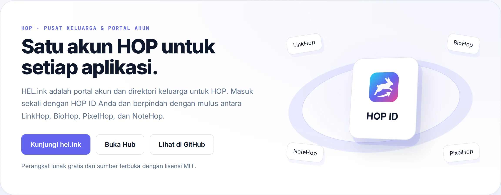

<p align="center">🌐 <a href="README.md">English</a> · <a href="README.zh.md">简体中文</a> · <a href="README.es.md">Español</a> · <a href="README.ar.md">العربية</a> · <a href="README.pt.md">Português</a> · <a href="README.fr.md">Français</a> · <a href="README.ja.md">日本語</a> · <b>Bahasa Indonesia</b></p>

# HEL.ink — Pusat Keluarga HOP & HOP ID

<p align="center">
  <a href="LICENSE"></a>
  <a href="https://github.com/navi-crwn/HEL.ink/actions/workflows/tests.yml"></a>
</p>

<p align="center"><picture><source media="(prefers-color-scheme: dark)" srcset="docs/readme/hero-id-dark.webp"></picture></p>

<p align="center"><b>Satu akun HOP untuk setiap aplikasi — masuk sekali dan jelajahi seluruh ekosistem.</b></p>

<p align="center">
  <a href="https://hel.ink">hel.ink</a> ·
  <a href="https://hub.hel.ink">hub.hel.ink</a> ·
  <a href="#jalankan-sendiri">Jalankan sendiri</a> ·
  <a href="#fitur-utama">Fitur</a> ·
  <a href="#faq">FAQ</a> ·
  <a href="#keamanan">Keamanan</a> ·
  <a href="#lisensi">Lisensi</a>
</p>

---

## Apa itu HEL.ink?

**HEL.ink** (Hop Easy Link) adalah beranda dan portal akun bagi keluarga aplikasi web **HOP** yang menjaga privasi dan dapat dipasang mandiri.

Repositori ini bertindak sebagai **pusat ekosistem**:
1. **Beranda publik (`hel.ink`)**: Memperkenalkan keluarga aplikasi, panduan pengguna, serta melayani aset merek dan tipografi terpusat.
2. **Portal akun (`hub.hel.ink`)**: Menerbitkan tiket SSO bertanda tangan, mengelola profil HOP ID, 2FA, pemulihan kata sandi, dan pemutusan sesi.
3. **Paket bersama (`hop-auth`, `hop-ui`, `hop-safety`)**: Fondasi autentikasi, layout antarmuka, dan pemindaian ancaman.

<a id="fitur-utama"></a>

## Fitur Utama

- **Single Sign-On (HOP ID)**: Satu akun untuk masuk ke LinkHop, BioHop, PixelHop, dan NoteHop dengan tiket bertanda tangan dan pemutusan sesi berantai.
- **Peluncur Aplikasi Terpadu**: Bilah navigasi atas terintegrasi untuk berpindah cepat antar-aplikasi keluarga HOP.
- **Keamanan Akun Tangguh**: Hashing Argon2id, autentikasi 2FA TOTP, proteksi bot Cloudflare Turnstile, dan verifikasi email.
- **Basis Data Bersama**: Satu basis data identitas dengan tabel migrasi terisolasi per aplikasi (`migrations_hub`, `migrations_bio`, dsb.).
- **Pengawas Layanan Langsung**: Pemeriksaan kesehatan otomatis dan pemantauan latensi tanpa kebocoran data rahasia.
- **Aset Keluarga Terpusat**: Logo resmi, font keluarga (Syne, Plus Jakarta Sans), dan tile 3D dengan hash integritas SRI.
- **Token API Berlingkup**: Token berlingkup untuk otomatisasi antar-aplikasi dan integrasi pengembang.
- **100% Gratis & Open Source**: Lisensi MIT, tanpa telemetri pelacak, dapat dihosting mandiri sepenuhnya.

<a id="jalankan-sendiri"></a>

## Jalankan sendiri

Prasyarat: PHP 8.3+, Composer, Node.js 22+, serta SQLite atau MySQL/MariaDB.

```bash
git clone https://github.com/navi-crwn/HEL.ink.git
cd HEL.ink
composer install
cp .env.example .env && php artisan key:generate
php artisan migrate
npm install && npm run build
php artisan serve
```

<a id="faq"></a>

## FAQ

**Apa itu HOP ID?**
HOP ID adalah layanan identitas pusat untuk keluarga HOP. Satu akun membuka akses ke semua aplikasi.

**Bisakah menjalankan hub tanpa aplikasi lain?**
Ya. Hub dapat berjalan mandiri sebagai direktori dan portal akun.

**Bagaimana cara kerja logout berantai?**
Saat Anda keluar dari hub, sesi lokal diakhiri dan sinyal pemutusan dikirimkan ke aplikasi terhubung.

<a id="keluarga-hop"></a>

## Keluarga HOP

HEL.ink adalah bagian dari keluarga aplikasi web **HOP** open-source di balik [hel.ink](https://hel.ink).

| Aplikasi | Alamat | Kode | Kegunaan |
| --- | --- | --- | --- |
| **HOP ID** | [hel.ink](https://hel.ink) · akun di `hub.hel.ink` | repo ini | Portal akun dan login satu pintu untuk semua app. |
| **LinkHop** | [link.hel.ink](https://link.hel.ink) · `hel.ink/l/…` | [navi-crwn/LinkHop](https://github.com/navi-crwn/LinkHop) | Pemendek tautan, kode QR, dan analitik klik. |
| **BioHop** | [bio.hel.ink](https://bio.hel.ink) · `hel.ink/b/…` | [navi-crwn/BioHop](https://github.com/navi-crwn/BioHop) | Halaman link-in-bio untuk semua profil Anda. |
| **PixelHop** | [pixel.hel.ink](https://pixel.hel.ink) · `p.hel.ink/…` | [navi-crwn/PixelHop](https://github.com/navi-crwn/PixelHop) | Hosting gambar dengan album dan tautan langsung. |
| **NoteHop** | [note.hel.ink](https://note.hel.ink) · `n.hel.ink/…` | [navi-crwn/NoteHop](https://github.com/navi-crwn/NoteHop) | Catatan privat terenkripsi yang dibagikan lewat tautan. |

<a id="keamanan"></a>

## Keamanan

Menemukan kerentanan? Laporkan secara privat melalui GitHub Security Advisories: [github.com/navi-crwn/HEL.ink/security/advisories](https://github.com/navi-crwn/HEL.ink/security/advisories). Jangan membuka isu publik untuk masalah keamanan. Lihat [SECURITY.md](SECURITY.md) untuk rincian lengkap.

<a id="lisensi"></a>

## Lisensi

[MIT](LICENSE) — bebas dan terbuka.

---

<p align="center"><sub>HEL.ink · HOP ID · bagian dari keluarga HOP · <a href="https://hel.ink">hel.ink</a></sub></p>
