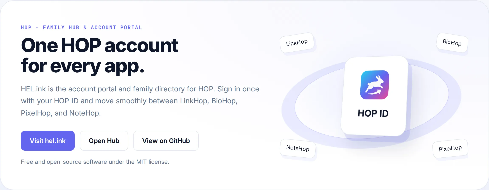

<p align="center">🌐 <b>English</b> · <a href="README.zh-CN.md">简体中文</a> · <a href="README.de.md">Deutsch</a> · <a href="README.id.md">Bahasa Indonesia</a> · <a href="README.ja.md">日本語</a> · <a href="README.pt-BR.md">Português (Brasil)</a> · <a href="README.es.md">Español</a> · <a href="README.fr.md">Français</a> · <a href="README.ru.md">Русский</a></p>

# HEL.ink — The HOP Family Hub & HOP ID

<p align="center">
  <a href="LICENSE"></a>
  <a href="https://github.com/navi-crwn/HEL.ink/actions/workflows/tests.yml"></a>
</p>

<p align="center"><picture><source media="(prefers-color-scheme: dark)" srcset="docs/readme/hero-en-dark.webp"></picture></p>

<p align="center"><b>One HOP account for every app — sign in once and move freely across the ecosystem.</b></p>

<p align="center">
  <a href="https://hel.ink">hel.ink</a> ·
  <a href="https://hub.hel.ink">hub.hel.ink</a> ·
  <a href="#run-your-own">Run your own</a> ·
  <a href="#features">Features</a> ·
  <a href="#faq">FAQ</a> ·
  <a href="#security">Security</a> ·
  <a href="#license">License</a>
</p>

---

Install in one command (it checks your computer first, asks a few questions, and can set up the HOP ID hub for you):

```bash
curl -fsSL https://raw.githubusercontent.com/navi-crwn/HEL.ink/main/install.sh | bash
```

From a clone: `./install.sh` · update: `./update.sh` · remove: `./uninstall.sh`. Add `--yes` to take every default; `--help` lists the options.

Everything at once (the hub plus any of LinkHop, BioHop, NoteHop, PixelHop and FileHop, already connected):

```bash
curl -fsSL https://raw.githubusercontent.com/navi-crwn/HEL.ink/main/install-family.sh | bash
```

## What is HEL.ink?

**HEL.ink** (Hop Easy Link) is the home and account portal of the **HOP** family of privacy-respecting, self-hostable web applications.

This repository serves as the **ecosystem hub**:
1. **Public home page (`hel.ink`)**: Introduces the family, guides new users, and hosts centralized family branding and typography assets.
2. **Account portal (`hub.hel.ink`)**: Issues signed single sign-on (SSO) tickets for member apps, manages HOP ID user profiles, 2FA, password resets, and session termination.
3. **Shared packages (`hop-auth`, `hop-ui`, `hop-safety`)**: Provides foundational authentication, UI layouts, navigation switchers, and threat scanning across all Laravel-based HOP apps.

<a id="features"></a>

## Features

- **🔐 Single Sign-On (HOP ID)**: One account signs you into LinkHop, BioHop, PixelHop, NoteHop, and FileHop without repetitive credentials. Signed cryptographic tickets and chained session termination.
- **🚀 Unified App Launcher**: An integrated top-level switcher letting users jump between all family apps seamlessly.
- **🛡️ Comprehensive Account Security**: Argon2id password hashing, TOTP two-factor authentication, Cloudflare Turnstile anti-bot verification, and secure email verification.
- **🧱 SSO gate, CSP and shared UI**: Every page is served with a Content-Security-Policy (nonce-based on the app pages), the SSO hand-off is signed and verified by the apps, and dialogs and the language and account menus come from the shared HopUI package.
- **🎛️ One control standard**: Inputs, selects and buttons share one radius and height (`--hop-ctl-*` tokens), 16 px text and 44 px touch targets on phones, and a static layout under reduced motion.
- **🗄️ Shared Identity Database**: Single MySQL or SQLite identity backend with isolated per-app migration tables (`migrations_hub`, `migrations_bio`, etc.) to prevent schema pollution.
- **📡 Live Service Watchdog**: Scheduled background health checks and latency monitoring for all member apps with zero credential exposure in public status JSON.
- **🎨 Central Asset Delivery**: Official marks, Syne/Plus Jakarta Sans/JetBrains Mono fonts, and floating 3D canvas tiles served with SRI hashes from `hel.ink/hop-assets/v2/`.
- **🔑 Fine-Grained API Tokens**: Scoped tokens (OAuth-style) enabling secure inter-app automation and developer access.
- **🌐 100% Free & Open Source**: MIT licensed, no telemetry, no paywalls, completely self-hostable.

<a id="run-your-own"></a>

## Run your own

Prerequisites: PHP 8.3+, Composer, Node.js 22+, and SQLite or MySQL/MariaDB.

```bash
git clone https://github.com/navi-crwn/HEL.ink.git
cd HEL.ink
composer install
cp .env.example .env && php artisan key:generate
php artisan migrate
npm install && npm run build
php artisan serve
```

### Configuration

Open `.env` (detailed in `.env.example`) to configure essential settings:

| Key | Description |
|---|---|
| `APP_URL` | Public front-facing address (`https://hel.ink`) |
| `HUB_HOST` | Hostname for the accounts portal (`hub.hel.ink`) |
| `HOP_SSO_SECRET` | Secret key (32+ random characters) for signing SSO tickets |
| `DB_CONNECTION`, `DB_*` | Database connection settings |
| `DB_MIGRATIONS_TABLE` | Keep set to `migrations_hub` to isolate the hub's migration history |

Run tests:
```bash
php artisan test
```

<a id="faq"></a>

## FAQ

**What is HOP ID?**
HOP ID is the central identity provider for the HOP family. Creating one account lets you sign into LinkHop, BioHop, PixelHop, NoteHop, and FileHop with zero friction.

**Can I run the hub without other apps?**
Yes. You can run the hub standalone as a directory and user account portal, but it shines best when powering member apps.

**How does logout work across apps?**
When you log out from the hub, your session is terminated locally and chained logout requests are dispatched to connected applications.

**Can I host everything on one VPS?**
Yes. All HOP applications are designed to share a database and live harmoniously on a single server or container environment.

<a id="family"></a>

## Self-hosting

<!-- self-hosting:start -->
Everything HEL.ink needs is in public repositories: no private repository, no token and no hel.ink account. The family guide has the details: [docs/self-hosting.md](https://github.com/navi-crwn/HEL.ink/blob/main/docs/self-hosting.md).

| Piece | For HEL.ink | What it does |
| --- | --- | --- |
| [HEL.ink](https://github.com/navi-crwn/HEL.ink) (hub, HOP ID) | This repository | Accounts and sign-in for every app |
| [hop/auth](https://github.com/navi-crwn/hop-auth), [hop/ui](https://github.com/navi-crwn/hop-ui), [hop/safety](https://github.com/navi-crwn/hop-safety) | Bundled in `packages/` | Shared PHP code: sign-in, interface, link safety |
| [Imperium](https://github.com/navi-crwn/Imperium) | Optional | Admin panel for the whole family; needs the hub |
| Family fonts and tiles | Nothing to install: loaded from `hel.ink/hop-assets` | Without hel.ink: system fonts, no floating tiles |

- **Install order**: this hub first, then the apps, then Imperium if you want it. Register the apps with `php artisan db:seed --class='Database\Seeders\HopAppsSeeder' --force`. [`install-family.sh`](install-family.sh) does all of it in one go.
- **Minimum settings**: `APP_URL`, `HUB_HOST`, `HOP_SSO_SECRET`, `DB_*`, `LINKHOP_URL` … `FILEHOP_URL` (one per app); with Imperium: `HOP_CONTROL_URL`, `HOP_SSO_SECRET_IMPERIUM`.
- **Alone or in the family**: the hub alone gives accounts, sign-in and the launcher; each app's README says what else it needs.
- **Without Imperium**: the hub keeps its own admin pages for accounts (`/admin`); Imperium adds the apps' content, reports and health.
<!-- self-hosting:end -->

## The HOP family

HEL.ink is part of the **HOP** family of self-hostable open-source apps behind [hel.ink](https://hel.ink).

<!-- hop-family:start -->
<!-- Generated from HEL.ink resources/hop-assets/apps.source.json; edit there, then run scripts/hop_assets.py build. -->
| App | Address | Repository | What it does |
| --- | --- | --- | --- |
| **HOP ID** | [hel.ink](https://hel.ink) · accounts at `hub.hel.ink` | [navi-crwn/HEL.ink](https://github.com/navi-crwn/HEL.ink) | One account for every HOP app. |
| **LinkHop** | [link.hel.ink](https://link.hel.ink) · `hel.ink/l/…` | [navi-crwn/LinkHop](https://github.com/navi-crwn/LinkHop) | Short links, QR codes and click analytics. |
| **BioHop** | [bio.hel.ink](https://bio.hel.ink) · `hel.ink/b/…` | [navi-crwn/BioHop](https://github.com/navi-crwn/BioHop) | One link-in-bio page for everything you do. |
| **PixelHop** | [pixel.hel.ink](https://pixel.hel.ink) · `p.hel.ink/…` | [navi-crwn/PixelHop](https://github.com/navi-crwn/PixelHop) | Image hosting with albums and direct links. |
| **NoteHop** | [note.hel.ink](https://note.hel.ink) · `n.hel.ink/…` | [navi-crwn/NoteHop](https://github.com/navi-crwn/NoteHop) | Encrypted notes you share with a link. |
| **FileHop** | [file.hel.ink](https://file.hel.ink) | [navi-crwn/FileHop](https://github.com/navi-crwn/FileHop) | Convert files in your browser; nothing is uploaded. |
| **Imperium** | not public-facing: optional, for admins | [navi-crwn/Imperium](https://github.com/navi-crwn/Imperium) | The HOP control panel. |
<!-- hop-family:end -->

## Changelog

Changes are listed in [CHANGELOG.md](CHANGELOG.md). The `/changelog` page of the site shows the merged pull requests and commits of every public HOP app.

<a id="security"></a>

## Security

Found a vulnerability? Please report it privately through GitHub's security advisories: [github.com/navi-crwn/HEL.ink/security/advisories](https://github.com/navi-crwn/HEL.ink/security/advisories). Do not open public issues for security vulnerabilities. See [SECURITY.md](SECURITY.md) for full details.

<a id="license"></a>

## License

[MIT](LICENSE) — free and open source.

---

<p align="center"><sub>HEL.ink · HOP ID · part of the HOP family · <a href="https://hel.ink">hel.ink</a></sub></p>
