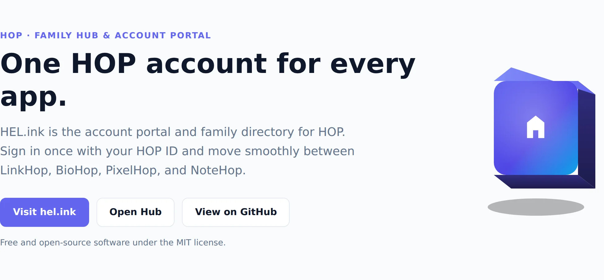

<p align="center">🌐 <a href="README.md">English</a> · <b>简体中文</b> · <a href="README.es.md">Español</a> · <a href="README.ar.md">العربية</a> · <a href="README.pt.md">Português</a> · <a href="README.fr.md">Français</a> · <a href="README.ja.md">日本語</a> · <a href="README.id.md">Bahasa Indonesia</a></p>

# HEL.ink — HEL.ink · HOP 家族中心与 HOP ID

<p align="center">
  <a href="LICENSE"></a>
  <a href="https://github.com/navi-crwn/HEL.ink/actions/workflows/tests.yml"></a>
</p>

<p align="center"><picture><source media="(prefers-color-scheme: dark)" srcset="docs/readme/hero-en-dark.webp"></picture></p>

<p align="center"><b>HEL.ink 是 HOP 的账户门户和家族目录。只需使用 HOP ID 登录一次，即可在 LinkHop、BioHop、PixelHop 和 NoteHop 之间无缝切换。</b></p>

<p align="center">
  <a href="https://hel.ink">hel.ink</a> ·
  <a href="https://hub.hel.ink">hub.hel.ink</a> ·
  <a href="#run">自建部署</a> ·
  <a href="#features">功能特性</a> ·
  <a href="#faq">常见问题</a> ·
  <a href="#family">HOP 家族</a>
</p>

---

## 家族中心与账户门户

适用于 LinkHop、BioHop、PixelHop 和 NoteHop 的中心账户门户、HOP ID 单点登录和家族目录。

<a id="features"></a>

## 功能特性

- **单点登录 (HOP ID)**: 一次登录覆盖所有 HOP 应用。签名凭证与链式登出确保会话一致。
- **统一应用启动器**: 随时随地一键在 LinkHop、BioHop、PixelHop 和 NoteHop 间切换。
- **共享数据库架构**: 共享单个 MySQL 或 SQLite 数据库存储身份，各应用独立的迁移账本避免冲突。
- **严格的安全防护**: Argon2id 哈希、TOTP 双重认证、Cloudflare Turnstile 防护与邮箱验证。
- **实时看门狗监测**: 自动健康监测与延迟监控，零密钥泄露。
- **集中式家族资产**: 官方图标、家族字体（Syne、Plus Jakarta Sans）和 3D 浮动卡片由 hel.ink 提供 SRI 支持。
- **细粒度 API 令牌**: 生成带权限范围的令牌，用于应用间通信与开发者自动化。
- **完全开源与自建**: 100% 自由开源。可独立运行 hub，也可在单个 VPS 上部署整个 HOP 生态。

<a id="run"></a>

## 自建您的 Hub

Hub 运行在标准现代 PHP 基础设施上。

```bash
git clone https://github.com/navi-crwn/HEL.ink.git
cd HEL.ink
composer install
cp .env.example .env && php artisan key:generate
php artisan migrate
npm install && npm run build
php artisan serve
```

<a id="faq"></a>

## 常见问题

**什么是 HOP ID？**
HOP ID 是 HOP 家族的集中认证系统。拥有一个账户即可使用所有 HOP 应用。

**我能单独运行 Hub 吗？**
可以。Hub 可以作为独立的账号与目录服务运行，但配合 HOP 应用体验最佳。

**单点登出如何工作？**
从 Hub 登出将销毁本地会话，并向所有已连接的应用发送链式登出信号。

**HEL.ink 是开源的吗？**
是的，HEL.ink 和所有公开的 HOP 应用均采用宽松的 MIT 许可证。

<a id="family"></a>

## HOP 家族

HEL.ink 是注重隐私的开源应用家族中心。

| 应用 | 线上地址 | 代码 | 功能 |
| --- | --- | --- | --- |
| **HOP ID** | `hel.ink` · `hub.hel.ink` | 本仓库 | 账户门户，HOP ID 登录 |
| **LinkHop** | `link.hel.ink` · `hel.ink/l/…` | [navi-crwn/LinkHop](https://github.com/navi-crwn/LinkHop) | 短链接与二维码生成 |
| **BioHop** | `bio.hel.ink` · `hel.ink/b/…` | [navi-crwn/BioHop](https://github.com/navi-crwn/BioHop) | 个人主页与链接展示 |
| **PixelHop** | `pixel.hel.ink` · `p.hel.ink/…` | [navi-crwn/PixelHop](https://github.com/navi-crwn/PixelHop) | 图片与媒体存储托管 |
| **NoteHop** | `note.hel.ink` · `n.hel.ink/…` | [navi-crwn/NoteHop](https://github.com/navi-crwn/NoteHop) | 客户端加密的私密便签 |

<a id="security"></a>

## 帮助与支持

发现问题或需要协助？请在以下地址提交议题： <a href="https://github.com/navi-crwn/HEL.ink/issues">GitHub Issues</a>或提交拉取请求。

---

<p align="center"><sub>HEL.ink · HOP ID · HOP 家族的一员 · <a href="https://hel.ink">hel.ink</a></sub></p>
